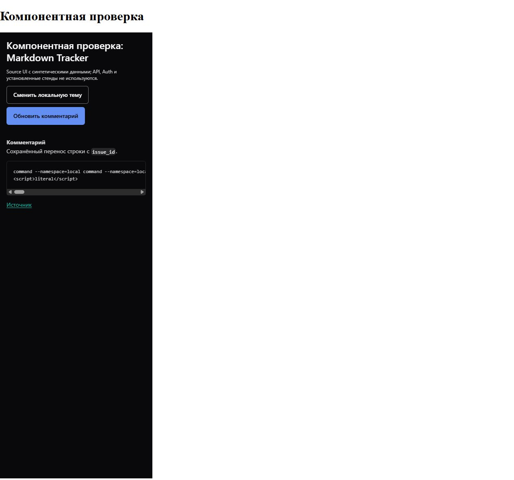

# Общий UI Base: Markdown и защита ухода

Source-компонентная проверка на синтетических данных, dark, измеренная ширина
iframe 375px. Это не установленное приложение: API, Auth, backend и реальные
пользовательские данные не использовались. Полный кадр сохранён без обрезки;
белая область вне iframe принадлежит драйверу проверки.

Настоящий CommentBody выводит fenced code через CodeBlock Base. Проверены
безопасная разметка, горизонтальная прокрутка, focus при смене темы и
обновление/сброс текста без устаревшего кода. Парсер остаётся у Tracker.

Отдельные private fullPage-кадры 1920/2560 просмотрены; матрица также включает
320px, light/dark/gray. Отсутствие overflow проверено геометрией.

